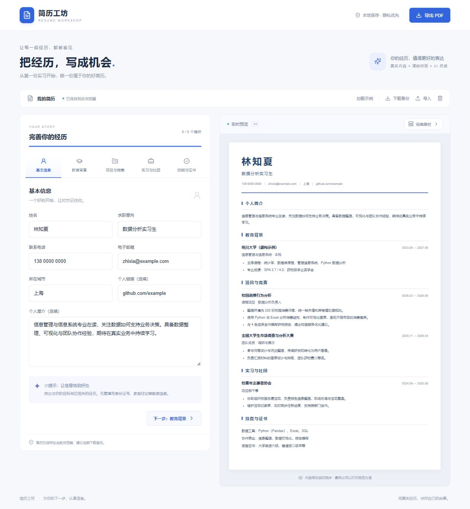

# 简历工坊 · Resume Workshop

面向大学生的全栈 AI 简历编辑与求职决策助手，作为「大数据与管理决策」课程的 vibe coding 项目开发。

> 在线地址：https://resume-workshop.resume-workshop.workers.dev 。已部署到 Cloudflare Workers，首次域名启用后的访问验证正在进行。默认内容全部为虚构示例。

## 需求与课程关联

大学生需要了解岗位要求、整理经历证据，并决定优先补充哪些信息或技能。项目以“岗位文本与简历 → 信息提取 → 证据对照 → 行动建议”为分析流程，将非结构化文本用于求职准备决策。当前是小规模个人决策原型，不宣称使用了大规模就业数据。

## 新增：岗位分析与求职决策

展开首页的“岗位分析与求职决策”，粘贴职位描述或加载标注为虚构的示例，输入演示口令，即可对照当前简历生成岗位核心要求、逐项证据与优先行动建议。分析复用真实 DeepSeek 服务，不生成未经验证的匹配分数。“未体现”不等于“不会”，结果需要用户核实。修改材料后旧结果会明确标记。

仅发送岗位描述和经历、技能等分析材料，不发送简历中的姓名和联系字段；正文中自行填写的个人信息仍可能被发送。结果暂存于当前页面，不纳入简历备份。新增接口操作为 `POST /api/polish` 的 `action: "analyze"`，分析材料上限 16,000 字；原有润色操作保持 2,000 字限制。

后续构思：在注明样本来源和数量的前提下，增加多岗位技能需求统计，辅助学习方向选择。该功能尚未实现。

## Cloudflare 部署

使用 OpenNext 适配，运行 `pnpm cf:build` 后运行 `pnpm cf:deploy`。服务端配置通过 Wrangler Secrets 设置 `DEEPSEEK_API_KEY` 和 `DEMO_PASSWORD`，不能提交到仓库。Windows 如遇符号链接权限错误，可在临时目录使用 npm 普通依赖布局构建，保留原仓库不变。已构建的产物可以使用 `wrangler deploy --no-autoconfig` 发布，避免重复框架检测。



## 基本用途

帮助准备实习、竞赛或学生组织申请的同学整理个人经历，实时查看排版，并导出可投递的 A4 简历。无需创建账户，简历保存在当前浏览器中。

## 功能

- 基本信息、教育背景、项目竞赛、实习社团和技能证书五个模块。
- 经历新增、删除、上下排序；空模块自动隐藏。
- 经典单栏、简洁双栏、学术黑白、现代简约、雅致商务五套模板，切换时保留内容。
- 实时预览、浏览器自动保存、JSON 备份导入导出。
- A4 打印／另存为 PDF；电脑双栏编辑，手机切换编辑和预览。
- DeepSeek 真实 AI：润色表达、精简字数、提出补充问题。
- AI 原文对比、采纳、保留原文及撤销最近一次采纳；检测旧建议，避免覆盖后续修改。

## 设计思路

采用 Next.js App Router + React + TypeScript。前端使用同一份简历数据驱动表单与模板，切换模板只改变外观，不修改内容。`localStorage` 保存编辑进度，带版本号的 JSON 文件用于跨设备备份；导入时先校验再确认替换。

服务端 `POST /api/polish` 验证演示口令，仅将选中的经历发送到 DeepSeek，密钥不进入网页代码。AI 只辅助表达，不替代事实核对。编辑和导出不依赖 AI 可用性，因此未配置密钥时仍能完成核心流程。

PDF 复用网页简历结构，通过打印样式隐藏编辑界面，设置 A4 页面和边距，减少屏幕与导出内容不一致的问题。使用系统中文字体，不依赖远程字体下载。

## 本地运行

需要 Node.js 20.9 或以上版本和 pnpm。推荐 Node.js 22/24。

```sh
pnpm install
pnpm dev
```

打开终端显示的本地地址，默认为 http://127.0.0.1:3000。

如需 AI，复制 `.env.example` 为 `.env.local`，填写：

```dotenv
DEEPSEEK_API_KEY=你的密钥
DEMO_PASSWORD=你设置的演示口令
DEEPSEEK_MODEL=deepseek-flash
```

`.env.local` 被 Git 忽略，不要提交、截图或公开真实值。修改配置后重新启动服务。没有配置时 AI 会明确提示尚未配置，不会返回伪造结果。

```sh
pnpm test
pnpm typecheck
pnpm build
pnpm start
```

## 使用方法

1. 加载虚构示例，或清空后填写自己的信息。
2. 在五个模块间切换，增加和调整经历。
3. 点击经历下方「AI 帮我写得更好」，输入演示口令，选择操作。
4. 核对建议的事实后采纳，或保留原文。
5. 选择模板，点击「导出 PDF」。在浏览器打印窗口中选择「另存为 PDF」、A4、100% 缩放，关闭页眉和页脚。
6. 定期下载备份；换设备或清理浏览器前尤其需要备份。

## 备选部署说明：Netlify

在 Netlify Free 账号中导入本 GitHub 仓库，使用仓库内 `netlify.toml`：构建命令为 `pnpm build`，发布目录为 `.next`，Node.js 版本为 22。Netlify 自动适配 Next.js 的页面与服务端接口，不应把项目当作纯静态网站部署。

在 Netlify 环境变量设置中填写 `DEEPSEEK_API_KEY`、`DEMO_PASSWORD` 和 `DEEPSEEK_MODEL`，允许服务端 Functions 使用，随后重新部署。不要使用 `NEXT_PUBLIC_` 前缀。密钥和演示口令不进入仓库。

发布后验证在线页面、AI、备份和打印，并将实际地址填入 README 顶部。免费方案有使用额度，应关注控制台用量。

参考：[Netlify Next.js 支持](https://docs.netlify.com/build/frameworks/framework-setup-guides/nextjs/overview/)。

## 备选：部署到 Vercel

1. 将代码提交到自己的 GitHub 仓库，包含 `pnpm-lock.yaml`，不上传 `node_modules`、`.next` 和任何真实密钥。
2. 在 Vercel 中导入该仓库，框架选择 Next.js，根目录为仓库根目录。
3. 配置服务端环境变量 `DEEPSEEK_API_KEY`、`DEMO_PASSWORD`、`DEEPSEEK_MODEL`，不要使用 `NEXT_PUBLIC_` 前缀。
4. 部署后验证公开地址能在未登录窗口打开，再测试编辑、导出和 AI。
5. 将真实在线地址添加到本 README 顶部；演示口令私下分享，不写入仓库。

参考：[Vercel GitHub 部署](https://vercel.com/docs/git/vercel-for-github)、[DeepSeek API](https://api-docs.deepseek.com/)。

## 接口

`POST /api/polish`：请求头 `x-demo-password`；JSON 请求体 `{ "action": "polish | shorten | suggest", "text": "经历文本" }`。成功返回 `{ "suggestion": "建议内容" }`，失败返回 `{ "error": "中文错误说明" }`。

单次经历限制 2,000 字，服务端请求超时 45 秒。口令错误、参数错误、未配置、供应商故障均有明确处理，不返回上游密钥或原始错误信息。

## 验证与局限

自动测试覆盖备份往返、损坏格式、重复编号、超量条目、AI 参数/口令/配置校验，以及模拟服务成功、超时和异常返回。模拟接口测试不等同于真实 DeepSeek 联调。

- 浏览器保存不等于云端同步；清理浏览器数据会丢失简历，请下载备份。
- AI 输出可能不准确；提示词限制不能保证绝无编造，采纳前必须核对。
- 口令保护适合小范围课程演示。10 秒间隔在浏览器端实现，只防止重复点击，不是服务端限流或费用硬上限。不要把口令公开传播。
- 首版不设数据库、账户或全站调用配额。面向大量公众开放前应增加持久化限流与费用控制。
- PDF 分页由浏览器处理，较长经历可能跨页；正式使用前检查打印预览。双栏长文尤其需要检查。
- 不同设备的系统字体和打印选项可能导致排版差异。

## Vibe coding 过程

先与 AI 讨论场景、功能边界和验收标准，再由 AI 辅助实现，经过类型检查、构建、自动测试与浏览器交互验证后迭代。项目强调可运行的完整流程、真实数据表达和清晰的前后端职责。

## 模板设计参考

参考 [Harvard 简历资源](https://careerservices.fas.harvard.edu/resources/?ctag%5B%5D=resume-cv-cover-letter-templates&shared_category=student) 的条目式信息组织，以及 [Overleaf 简历模板集](https://www.overleaf.com/latex/templates/tagged/cv) 中简约、学术和现代风格的设计方向。本项目独立实现 CSS 排版，不复制第三方模板代码或声称官方授权。五套模板共享同一份数据，切换后保存、备份与导入均保留模板选择。打印使用对应模板样式，较长内容仍需检查分页。

示例简历含原创插画头像，人物、院校、企业、经历与成果均为虚构，仅用于展示排版。已有编辑记录不会自动被新示例覆盖；点击“加载示例”并确认可查看新版，操作前请备份自己的内容。

## 岗位需求与实践规划（本地首批实现）

入口 `/career`，简历首页也提供入口。当前方向是国内数据分析实习，首批适配百度官方实习职位详情页。不是全网搜索：网页展示构建时生成的招聘快照，新增数据后需重新构建发布。

运行 `python scripts/collect_jobs.py` 采集默认验证页面；也可重复传入 `--url 官方实习详情链接`，每批最多20条、请求间隔2秒。检查 robots.txt，404视为未提供规则，其他失败停止；不使用账号、不处理验证码。数据写入本地 `data/jobs.sqlite`（不提交），按岗位ID去重，导出 `data/jobs.json`。保留原文、发布与采集时间、来源及失败记录。公开可读不代表无限批量授权，扩展来源前需核对适用条款。

界面按岗位统计技能提及数并展示原句。当前是关键词规则，不是AI能力评估；用户自行确认已有实践、学过待实践或需要学习，再获得明确标注的自主练习步骤及验收成果。可载入本浏览器简历的经历与技能、下载实践计划。不上传个人材料。本页状态暂不自动保存。

当前仅有一条真实样本，不能代表市场；未实现自动发现职位、定时任务、多企业覆盖和经核实的竞赛资源。这些仍属下一批工作，禁止将当前结果标为一万条岗位分析或全网采集。现有AI岗位分析入口仍保留。

### 第二批更新
招聘库当前有3条百度官方数据分析实习岗位，默认采集命令会逐一刷新这些固定详情页，尚不支持自动搜索发现新职位。工作台新增单岗位筛选及样本内技能统计，每张岗位卡片的标签仅依据该条原文。
实践计划提供UCI Online Retail数据来源、天池基础学习入口和成果说明模板，下载计划包含资源链接。学习赛参考来自天池官方入门路线，核查日期为2026-11-14；未核实当前报名时间和资格，明确标注学习参考而非可报名赛事。招聘样本仍未覆盖多企业，暂无市场代表性。

### 第三批更新
当前5条岗位，来自百度官网和牛客招聘平台，共3家企业。平台岗位不等于企业官网背书，发布日期及当前是否在招以原文为准。默认采集命令覆盖五条固定详情页，分别检查来源robots规则并按ID去重。
工作台将经历、筛选、能力确认、任务勾选与实践记录自动保存到浏览器，支持JSON进度备份与确认后恢复。自动保存不含账号云同步；清除浏览器数据会删除本地进度。恢复备份有版本、类型和长度校验，实践完成勾选是用户自我记录，不代表系统能力认证。

### 多专业与多岗位
新增独立的专业背景选择（15类具体专业及未选择/其他），专业仅作为用户背景记录，不作企业资格推断或强制岗位过滤。岗位现有数据分析、前端开发、产品与内容运营、产品、用户研究、模型评估与测试6个方向，共10条真实采集样本；方向由职位标题规则归类，可查看原文确认。新增方向大部分只有1条样本，统计不代表行业趋势。
新增前端、内容策划、产品分析、用户研究和测试评估自主练习；需求分析仅使用当前方向的岗位。专业与岗位保存到本地进度及备份，旧备份仍可恢复。当前新增练习提供任务及成果模板，外部专门课程资源仍待补充。

## 招聘数据持续核查
已接入百度官网与牛客平台的15条固定岗位链接、8家企业。定时工作流 `.github/workflows/refresh-jobs.yml` 计划每6小时核查一次（UTC 00:23、06:23、12:23、18:23）；需推送到默认分支并且GitHub Actions实际运行后才生效。调度可能延迟，公开仓库长期无活动时也可能暂停，不能承诺即时同步。
采集结果按岗位保存最后尝试、最后成功核查、内容变更时间；超时不会删除旧信息，404/410与明确截止信息会标记不可用。默认分析排除已截止和不可用岗位。平台转载可能落后于企业官网，页面保留来源和日期。
生产 `/api/jobs` 读取仓库最新数据，失败返回明确标注的随版本快照；浏览器每5分钟检查，服务端响应缓存最多5分钟，因此岗位数据更新不再要求重建网页。首次仍需发布包含该接口的网页版本。本地开发读取本地采集文件。
此版本更新已收录链接，不自动发现企业所有新增职位；扩大来源需要新增适配及链接。采集源失败会保留错误记录并使定时工作流显示失败。
