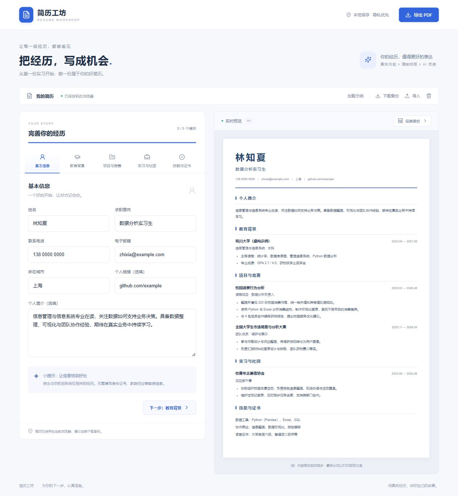

# 简历工坊 · Resume Workshop

面向大学生的轻量级全栈 AI 简历编辑器，作为「大数据与管理决策」课程的 vibe coding 项目开发。

> 发布状态：项目可本地运行，真实 AI 已联调通过。Netlify 部署已完成，但账号被平台暂停、站点仍要求登录，因此当前没有可供公众直接体验的在线演示。账号问题待平台支持处理。默认内容全部为虚构示例。



## 基本用途

帮助准备实习、竞赛或学生组织申请的同学整理个人经历，实时查看排版，并导出可投递的 A4 简历。无需创建账户，简历保存在当前浏览器中。

## 功能

- 基本信息、教育背景、项目竞赛、实习社团和技能证书五个模块。
- 经历新增、删除、上下排序；空模块自动隐藏。
- 经典单栏和简洁双栏模板，切换时保留内容。
- 实时预览、浏览器自动保存、JSON 备份导入导出。
- A4 打印／另存为 PDF；电脑双栏编辑，手机切换编辑和预览。
- DeepSeek 真实 AI：润色表达、精简字数、提出补充问题。
- AI 原文对比、采纳、保留原文及撤销最近一次采纳；检测旧建议，避免覆盖后续修改。

## 设计思路

采用 Next.js App Router + React + TypeScript。前端使用同一份简历数据驱动表单与模板，切换模板只改变外观，不修改内容。`localStorage` 保存编辑进度，带版本号的 JSON 文件用于跨设备备份；导入时先校验再确认替换。

服务端 `POST /api/polish` 验证演示口令，仅将选中的经历发送到 DeepSeek，密钥不进入网页代码。AI 只辅助表达，不替代事实核对。编辑和导出不依赖 AI 可用性，因此未配置密钥时仍能完成核心流程。

PDF 复用网页简历结构，通过打印样式隐藏编辑界面，设置 A4 页面和边距，减少屏幕与导出内容不一致的问题。使用系统中文字体，不依赖远程字体下载。

## 本地运行

需要 Node.js 20.9 或以上版本和 pnpm。推荐 Node.js 22/24。

```sh
pnpm install
pnpm dev
```

打开终端显示的本地地址，默认为 http://127.0.0.1:3000。

如需 AI，复制 `.env.example` 为 `.env.local`，填写：

```dotenv
DEEPSEEK_API_KEY=你的密钥
DEMO_PASSWORD=你设置的演示口令
DEEPSEEK_MODEL=deepseek-flash
```

`.env.local` 被 Git 忽略，不要提交、截图或公开真实值。修改配置后重新启动服务。没有配置时 AI 会明确提示尚未配置，不会返回伪造结果。

```sh
pnpm test
pnpm typecheck
pnpm build
pnpm start
```

## 使用方法

1. 加载虚构示例，或清空后填写自己的信息。
2. 在五个模块间切换，增加和调整经历。
3. 点击经历下方「AI 帮我写得更好」，输入演示口令，选择操作。
4. 核对建议的事实后采纳，或保留原文。
5. 选择模板，点击「导出 PDF」。在浏览器打印窗口中选择「另存为 PDF」、A4、100% 缩放，关闭页眉和页脚。
6. 定期下载备份；换设备或清理浏览器前尤其需要备份。

## 部署到 Netlify（当前方案）

在 Netlify Free 账号中导入本 GitHub 仓库，使用仓库内 `netlify.toml`：构建命令为 `pnpm build`，发布目录为 `.next`，Node.js 版本为 22。Netlify 自动适配 Next.js 的页面与服务端接口，不应把项目当作纯静态网站部署。

在 Netlify 环境变量设置中填写 `DEEPSEEK_API_KEY`、`DEMO_PASSWORD` 和 `DEEPSEEK_MODEL`，允许服务端 Functions 使用，随后重新部署。不要使用 `NEXT_PUBLIC_` 前缀。密钥和演示口令不进入仓库。

发布后验证在线页面、AI、备份和打印，并将实际地址填入 README 顶部。免费方案有使用额度，应关注控制台用量。

参考：[Netlify Next.js 支持](https://docs.netlify.com/build/frameworks/framework-setup-guides/nextjs/overview/)。

## 备选：部署到 Vercel

1. 将代码提交到自己的 GitHub 仓库，包含 `pnpm-lock.yaml`，不上传 `node_modules`、`.next` 和任何真实密钥。
2. 在 Vercel 中导入该仓库，框架选择 Next.js，根目录为仓库根目录。
3. 配置服务端环境变量 `DEEPSEEK_API_KEY`、`DEMO_PASSWORD`、`DEEPSEEK_MODEL`，不要使用 `NEXT_PUBLIC_` 前缀。
4. 部署后验证公开地址能在未登录窗口打开，再测试编辑、导出和 AI。
5. 将真实在线地址添加到本 README 顶部；演示口令私下分享，不写入仓库。

参考：[Vercel GitHub 部署](https://vercel.com/docs/git/vercel-for-github)、[DeepSeek API](https://api-docs.deepseek.com/)。

## 接口

`POST /api/polish`：请求头 `x-demo-password`；JSON 请求体 `{ "action": "polish | shorten | suggest", "text": "经历文本" }`。成功返回 `{ "suggestion": "建议内容" }`，失败返回 `{ "error": "中文错误说明" }`。

单次经历限制 2,000 字，服务端请求超时 45 秒。口令错误、参数错误、未配置、供应商故障均有明确处理，不返回上游密钥或原始错误信息。

## 验证与局限

自动测试覆盖备份往返、损坏格式、重复编号、超量条目、AI 参数/口令/配置校验，以及模拟服务成功、超时和异常返回。模拟接口测试不等同于真实 DeepSeek 联调。

- 浏览器保存不等于云端同步；清理浏览器数据会丢失简历，请下载备份。
- AI 输出可能不准确；提示词限制不能保证绝无编造，采纳前必须核对。
- 口令保护适合小范围课程演示。10 秒间隔在浏览器端实现，只防止重复点击，不是服务端限流或费用硬上限。不要把口令公开传播。
- 首版不设数据库、账户或全站调用配额。面向大量公众开放前应增加持久化限流与费用控制。
- PDF 分页由浏览器处理，较长经历可能跨页；正式使用前检查打印预览。双栏长文尤其需要检查。
- 不同设备的系统字体和打印选项可能导致排版差异。

## Vibe coding 过程

先与 AI 讨论场景、功能边界和验收标准，再由 AI 辅助实现，经过类型检查、构建、自动测试与浏览器交互验证后迭代。项目强调可运行的完整流程、真实数据表达和清晰的前后端职责。
